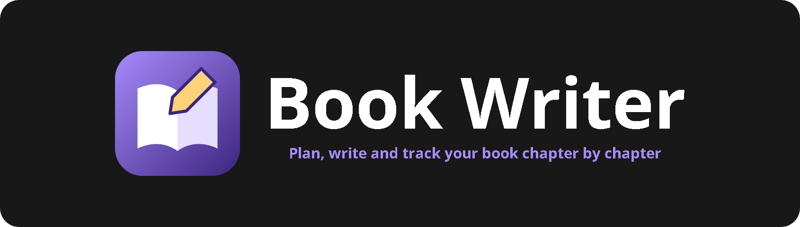
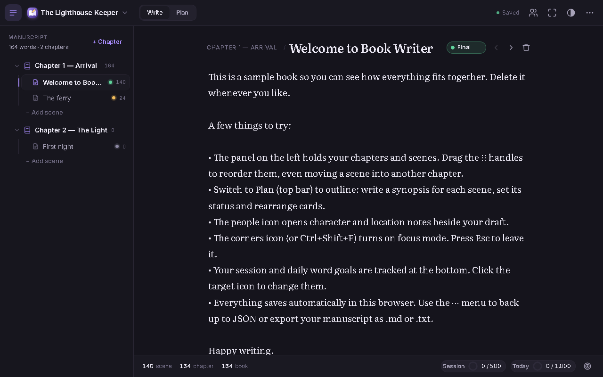

<p align="center"></p>

<p align="center">    </p>

A notes app built for writing books. Organise each book into chapters and scenes, write in a distraction-free editor, keep notes on characters and locations, and plan the story in an outline view.

<p align="center"></p>

## Features

- Books → chapters → scenes, drag to reorder with mouse or touch (scenes can move between chapters)
- Distraction-free focus mode with scene, chapter and book word counts
- Session and daily word goals with a 7-day history
- Searchable character and location notes panel
- Plan view with book synopsis, chapter summaries and scene cards (Idea / Draft / Revised / Final)
- Autosave, JSON backup and import (merge or replace), manuscript export as `.md` or `.txt`
- Light, dark or system theme, plus keyboard shortcuts

## Getting started

No build step and no dependencies. Clone the repo and open `index.html`, or serve the folder locally:

```bash
git clone https://github.com/Squidly1408/book-writer.git
cd book-writer
python -m http.server 8812
```

Then visit http://localhost:8812.

## Project structure

| File | Purpose |
|---|---|
| `index.html` | App shell |
| `js/app.js` | App logic, editor, drag and drop, export |
| `css/styles.css` | Styles and themes |
| `assets/` | Logo and README images |

## Built with

HTML, CSS, JavaScript, localStorage

## Limitations

- Data is stored in this browser only; use the JSON backup to move it or keep it safe
- Plain-text editor with no rich formatting
- Goal counts are net, so deleting text lowers them

## License

Released under the [MIT License](LICENSE).
